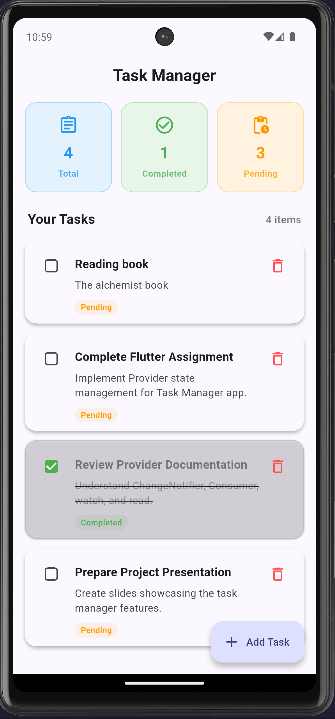
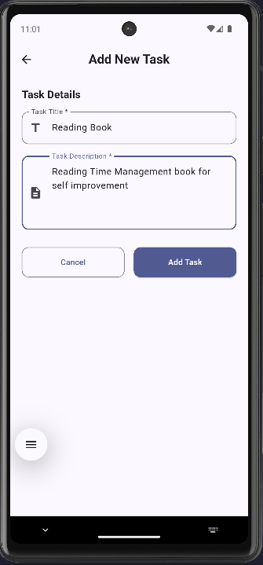
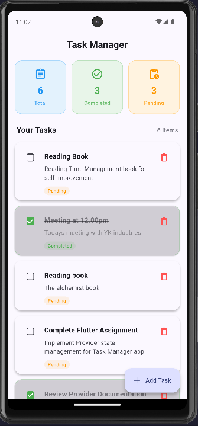

# Task Manager App - Provider State Management

A clean, modern, and feature-rich Flutter Task Manager application built for an academic assignment to demonstrate proper **Provider** state management.

---

## 📌 Project Overview

This application serves as a complete demonstration of state management using the `provider` package in Flutter. All task-related states—including task list updates, completion toggling, deletion, and real-time statistics calculation—are managed centrally through a single source of truth (`TaskProvider`). No local `setState()` is used for task-related state.

---

## ✨ Features

- **📊 Real-time Task Statistics**: Live counts for Total, Completed, and Pending tasks automatically updated upon any task modification.
- **📋 Task List View**: Rendered using `ListView.builder` displaying task titles, descriptions, status badges, and quick controls.
- **➕ Add New Task**: Dedicated screen with full form validation (Title & Description required).
- **✔️ Toggle Completion**: Interactive checkboxes allowing users to mark tasks as Completed or Pending with visual distinctions (strikethrough text, faded opacity, green status chips).
- **🗑️ Delete Task**: Quick task deletion with a safety confirmation dialog.
- **🎨 Modern Material 3 UI**: Clean card-based design, cohesive typography, and adaptive empty-state messaging.

---

## 🛠️ Technologies & Packages Used

- **Flutter SDK**: ^3.13.4
- **Dart**: Modern Dart with null safety
- **State Management**: [provider](https://pub.dev/packages/provider) (^6.1.2)
- **Design System**: Material Design 3

---

## 💡 Provider Concepts Demonstrated

This project strictly adheres to Provider state management principles:

| Concept | Implementation in Project |
| :--- | :--- |
| `ChangeNotifier` | `TaskProvider` extends `ChangeNotifier` to hold task state and logic. |
| `ChangeNotifierProvider` | Configured at application root in `main.dart` wrapping `MaterialApp`. |
| `notifyListeners()` | Called inside `addTask()`, `toggleTask()`, and `deleteTask()` to trigger UI updates. |
| `Consumer<TaskProvider>` | Used in `TaskStatistics` to reactively rebuild statistic cards when data changes. |
| `context.watch<TaskProvider>()` | Used in `TaskHomeScreen` to listen to task list changes and rebuild the UI. |
| `context.read<TaskProvider>()` | Used in `TaskCard` and `AddTaskScreen` to dispatch actions (`addTask`, `toggleTask`, `deleteTask`) without listening to state changes. |

> **Note**: `setState()` is **never** used for managing task data.

---

## 📂 Project Structure

```text
lib/
├── main.dart                  # Application root & ChangeNotifierProvider setup
├── models/
│   └── task.dart              # Task data model
├── providers/
│   └── task_provider.dart     # Task state management & statistics getters
├── screens/
│   ├── task_home_screen.dart  # Main dashboard & task list view
│   └── add_task_screen.dart   # Dedicated form screen for creating tasks
└── widgets/
    ├── task_card.dart         # Reusable card widget for individual tasks
    └── task_statistics.dart   # Stat cards widget listening to TaskProvider
```

---

## 🚀 Setup & Execution Instructions

### Prerequisites

- Flutter SDK installed (Version 3.13.0 or higher)
- Android Studio / VS Code with Flutter extension
- Android Emulator / iOS Simulator / Connected Device

### Running the App

1. **Clone or navigate to the repository directory**:
   ```bash
   cd task_managaer_app
   ```

2. **Fetch dependencies**:
   ```bash
   flutter pub get
   ```

3. **Run tests to verify functionality**:
   ```bash
   flutter test
   ```

4. **Launch the application**:
   ```bash
   flutter run
   ```

---

## 📸 Screenshots

| Home Dashboard | Add Task Form | Updated Task List |
| :---: | :---: | :---: |
|  |  |  |

---

## 📤 GitHub Submission Instructions

1. **Initialize Git repository (if not already done)**:
   ```bash
   git init
   git add .
   git commit -m "Initial commit - Complete Flutter Task Manager with Provider state management"
   ```

2. **Push to GitHub**:
   ```bash
   git remote add origin <your-github-repo-url>
   git branch -M main
   git push -u origin main
   ```

---

## 📜 License

This project is created for academic assignment purposes. Feel free to reference and learn from the Provider implementation!
